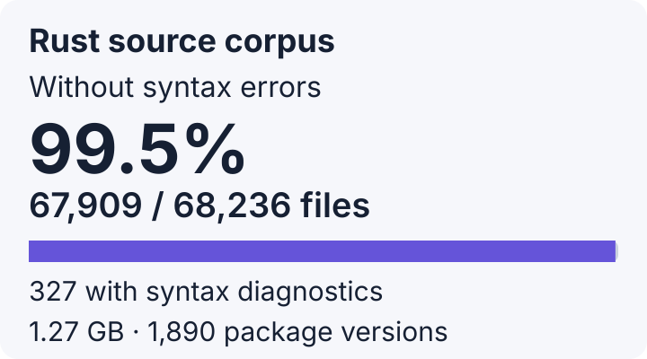

<h1 align="center">flux</h1>
<p align="center">A Rust toolchain aiming for full rustc and Cargo compatibility, built on Keel.</p>
<p align="center">
  <a href="rust-toolchain.toml"></a>
  <a href="Cargo.toml"></a>
  <a href="docs/SELF_HOSTING.md"></a>
  <a href="docs/SELF_HOSTING.md"></a>
  <a href="https://github.com/hxyulin/keel/commit/f503b7263f5ea2d85367a4e986027fea8ab9ce20"></a>
  <a href="#size"></a>
  <a href="https://github.com/hxyulin/flux-lang/actions/workflows/ci.yml"></a>
  <a href="#license"></a>
</p>
<p align="center">
  <a href="docs/ARCHITECTURE.md">Architecture</a> ·
  <a href="docs/LANGUAGE.md">Supported language</a> ·
  <a href="docs/SELF_HOSTING.md">Self-hosting</a> ·
  <a href="docs/ROADMAP.md">Roadmap</a> ·
  <a href="CHANGELOG.md">Changelog</a>
</p>

Flux aims to be a fully compatible alternative to **rustc and Cargo**: the same
Rust language and library behavior, existing Cargo projects, and familiar command
workflows. Compatibility is the goal; the implementation is still experimental
and has [documented gaps](docs/LANGUAGE.md).

`fluxc` compiles Rust source files; `flux` manages packages and dependencies.
Use `flux build` where you would use `cargo build`, and `flux run` where you
would use `cargo run`. Install both binaries together. Flux generates native
code through [Keel](https://github.com/hxyulin/keel), without LLVM in its
code-generation path. rustc is the correctness oracle: accepted programs must
have the same behavior under both compilers.

| Area | flux supports |
| --- | --- |
| Language | Edition 2024, with bounded earlier-edition modes; generics, traits, closures, async functions, `impl Trait`, unions and macros |
| Checking | Type inference, trait solving, a borrow checker, constant evaluation and rustc's overflow lints |
| Libraries | Its own `core`, `alloc` and a bounded `std`, written in flux, including threads, atomics, `OnceLock` and collections |
| Real crates | Unchanged sources of Rayon, rand, modern futures-util, regex, serde, hashbrown and more; selected API consumers compared with rustc on arm64 macOS |
| Builds | Cargo workspaces, native resolution and fetching, Flux-built build scripts and procedural macro hosts, parallel crate builds and disk artifact reuse |
| Backend | Native executables on arm64 macOS and x86-64 Linux, linked in-process with Keel |

Not supported yet: alternate registries, dependency overrides and
package-specific lockfile updates. The
[language reference](docs/LANGUAGE.md) lists every restriction.

## Compatibility

Parser census recorded on 2026-11-10, with rustc exclusion checks on 2026-11-11,
on arm64 macOS. [Counts and measurement scope](docs/status/compatibility.json).



The corpus contains 68,236 Rust files, 1.27 GB across 1,890 package versions.
Using each file's inferred package edition, Flux parses 68,183 files without
syntax diagnostics. Rustc's parse-only check also rejects 42 of the 53 remaining
files. Excluding those files gives **68,183 / 68,194 (99.98%)**, with 11
Flux-only syntax failures. Whole packages are not excluded. The clean files
were not individually checked with rustc.

All files produced valid, lossless syntax trees, with no panics or time-budget
failures. Edition inference uses the nearest package manifest; fixture overrides
and cfg are not applied. These counts measure parsing only. A current
full-corpus compilation success rate has not been measured.
[Per-file rustc controls](docs/status/rustc-parser-controls.json).


The recorded Rayon 1.12.0 qualification passes all 115 adapted integration cases,
including the four unwinding cases. The adapters retain upstream test bodies
and assertions. Another 24 selected rayon-core panic cases passed in fast-build
and release modes. The latest validation reran the ordinary consumer and core
unwind tests successfully, but the collection-unwind rebuild timed out.
The rand-dependent string cases build the default rand 0.9.5 dependency graph,
including zerocopy 0.8.63, without upstream source or feature changes.
These results cover the selected integration cases. The full 217-test unit
suite and 246 doctests remain unqualified; the latest unit attempt stopped
during zerocopy compilation. The separate maintained Rayon consumer also matches rustc in debug,
fast-build and release modes.

## Self-hosting

On arm64 macOS and x86-64 Linux, flux has built optimized stage 1 and stage 2
from the complete compiler source graph with pinned Keel `a078986c`, bbtree and
Verus. Stage 1 is built by a rustc-built Flux; stage 2 is built by stage 1.
The proofs use commit `1aacb10` plus the recorded library and frontend support
patches described in [docs/SELF_HOSTING.md](docs/SELF_HOSTING.md).

On each host, stage 2 is byte-for-byte identical to stage 1 and passed
help/version checks. Linux stage 2 passed ten compile/run comparisons in both
output optimization modes against rustc; the macOS proof covers seven programs
in both modes. The inventoried inputs stayed unchanged. Earlier macOS proofs
also cover building the compiler without `-O`.

x86-64 Linux supports native executable and local package builds, including
library artifact reuse. Process spawning, owned pipes and channels have native
Linux comparisons. Integer SSE/AVX2, the AVX-512 CRC folding subset, SHA-256 instructions and runtime
CPU detection have native Linux comparison coverage. Argument capture, recursive removal and
bounded integer inline assembly also run on Linux. x86-64 macOS and
Rosetta are not supported targets. The audited stage 2 proofs used Cargo and
rustc for host build scripts and procedural macros. Native offline builds now
prepare those host tools directly with rustc through `flux build`;
see [native source builds](crates/flux-cli/README.md#native-source-builds). See [docs/SELF_HOSTING.md](docs/SELF_HOSTING.md) for the audited graph,
verification scope and remaining blockers.

## Size

Counted with `tokei` on 2026-10-30, Rust only, vendored code excluded.

| Part | Lines |
| --- | ---: |
| flux compiler (`crates/*/src`) | 141k |
| flux libraries (`library/`) | 42k |
| Keel backend (`crates/*/src`) | 338k |
| **Compiler source, flux and Keel** | **521k** |
| flux tests | 134k |
| Keel tests, suite and tools | 172k |

As of 2026-11-10, `tests/run` holds 640 programs compiled and run against rustc.

## Compile time

<details>
<summary><strong>Measured against rustc on one source graph</strong></summary>

The tree fixture is flux's lexer, parser and tree modules plus the real
memchr and unicode-ident crates: four crates, about 8,700 lines. Measured on
arm64 macOS on 2026-10-30, medians of three runs, against rustc 1.99.1.
flux runs as one process on one thread.

| Clean build | flux | rustc, one job | Cargo, default jobs |
| --- | ---: | ---: | ---: |
| Unoptimized | 1.18 s | 1.01 s | 0.66 s |
| Optimized | 1.64 s | 2.02 s | 0.91 s |

These measurements predate the current package cache. Unchanged crates reuse
disk artifacts; unchanged macro expansions can reuse checked results. An opt-in
fast-build mode can reuse individual backend objects, keeping only their latest
versions. Source edits still rerun frontend checking for the affected crate;
per-function frontend incrementality remains future work. See the
[cache contract](crates/flux-cli/README.md#native-source-builds).

</details>

## Quickstart

flux builds with stable Rust. Native executable linking supports arm64 macOS
and x86-64 Linux. Linux needs an installed glibc C toolchain: `cc` locates the
startup objects and shared libraries, and Keel performs the link in-process.

<details>
<summary><strong>Build flux and compile a program</strong></summary>

```sh
git clone https://github.com/hxyulin/flux-lang.git
cd flux-lang
cargo build
target/debug/fluxc build-builtins   # prebuild the built-in library (optional)
```

```sh
target/debug/fluxc run tests/run/fib.rs        # compile and run a program
target/debug/fluxc build tests/run/fib.rs -O   # write an optimized executable
target/debug/fluxc build tests/run/fib.rs --fast-build # shorter optimization pipeline
target/debug/fluxc mir tests/run/fib.rs        # print its MIR
target/debug/fluxc check examples/*.rs         # report syntax errors
target/debug/flux build --manifest-path path/to/Cargo.toml
```

Without `build-builtins`, each run compiles the built-in library from source
first, which adds about half a second.

`--fast-build` uses fewer optimizer passes and keeps native instruction selection
enabled. Generated programs can run slower than with `-O`. The options are mutually
exclusive. Native package builds put fast-mode outputs in `target/flux/fast`;
debug assertions follow the release profile unless explicitly overridden.

</details>

<details>
<summary><strong>Run the tests</strong></summary>

```sh
just test-fast              # quick smoke plan
just test-fast borrowing    # one component
just check                  # format, clippy and the complete suite
```

See [CONTRIBUTING.md](CONTRIBUTING.md) for the test runner and its options.

</details>

## Documentation

- [Architecture](docs/ARCHITECTURE.md): the pipeline and its data structures.
- [Supported language](docs/LANGUAGE.md): what flux accepts and what it rejects.
- [Self-hosting](docs/SELF_HOSTING.md): the audited source graphs and the bootstrap.
- [Library artifacts](docs/FLIB.md): `.flib` files and the built-in library.
- [Package driver](docs/PACKAGE_DRIVER.md): building local Cargo packages.
- [Roadmap](docs/ROADMAP.md): what comes next.

## Contributing

- [CONTRIBUTING.md](CONTRIBUTING.md) covers setup, the test runner and conventions.
- Report a miscompile with the smallest program where flux and rustc disagree.
- [AGENTS.md](AGENTS.md) records repository conventions for coding assistants.

## License

flux is available under either the [MIT license](LICENSE-MIT) or the
[Apache License 2.0](LICENSE-APACHE), at your option.
